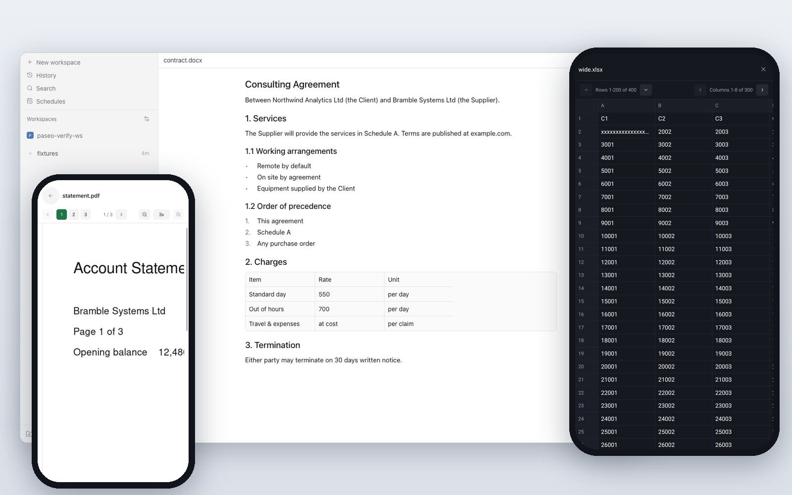

# PDF and Office viewer for Paseo



A [Paseo](https://github.com/getpaseo/paseo) plugin that shows PDF, Word, Excel, CSV, PowerPoint, image, video and audio files from your workspace inside the app, on desktop, web and mobile. Documents are rendered on the daemon host with pure JavaScript and WebAssembly, so nothing needs to be installed there. [OVERVIEW.md](OVERVIEW.md) describes what users see and the limits.

## Install

Requires Paseo 0.11.2 or later with plugins enabled, and `npm` on the daemon host.

```sh
paseo plugin install git:nkwib/paseo-doc-viewer
```

Plugins run unsandboxed on the daemon host. Read the code before you install it.

## Development

```sh
npm ci
npm run typecheck
npm test
```

`npm run test:browser` renders the viewer components in headless Chromium against the real RPC handlers, with a test DOM adapter in place of React Native. It does not replace checks inside Paseo. Run `npx playwright install chromium` first, or set `CHROMIUM_EXECUTABLE_PATH` to an existing Chromium.

For a real desktop or phone test workspace, run `node scripts/seed-media-fixtures.mjs /path/to/workspace/media-samples`. This requires FFmpeg on the development machine and creates five-second MP4, M4V, MOV and WebM clips with sound, plus WAV, MP3, M4A and FLAC tones. Existing files are preserved. Open Video or Audio in the Documents panel; native video currently shows the availability message.

[docs/host-api-proposals.md](docs/host-api-proposals.md) sketches Paseo host APIs the viewer would need for opening files from the Files tree, saving on mobile and streaming media.

Set `PASEO_SOURCE` to a checkout of `getpaseo/paseo` to also run the install test against Paseo's own plugin compiler. `scripts/install-check.sh` installs the committed HEAD into a throwaway Paseo home under `/tmp` and never touches `~/.paseo`.

[SCENARIOS.md](SCENARIOS.md) maps each test scenario to the reports in [getpaseo/paseo#3109](https://github.com/getpaseo/paseo/discussions/3109).

`@types/node` is a runtime dependency pinned to 22.x on purpose: Paseo's install-time type check fails on newer `node:` builtins. It can go once that is fixed upstream.

## License

MIT. See [LICENSE](LICENSE) and [NOTICE](NOTICE) for adapted code and third-party licenses.
